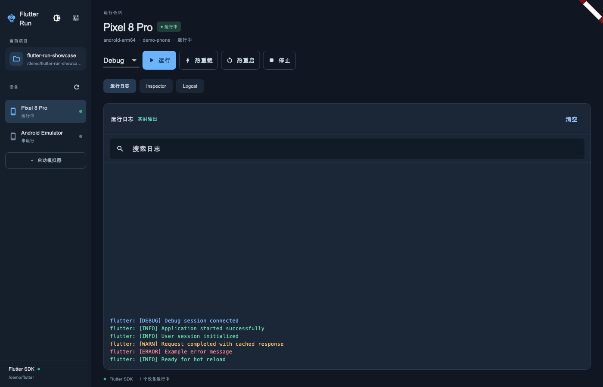
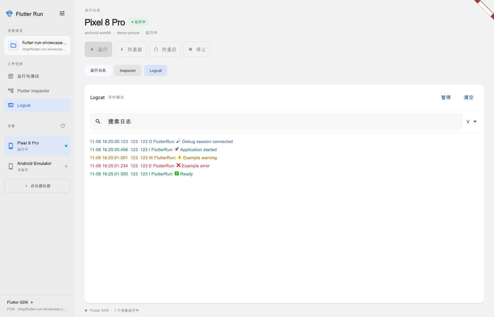
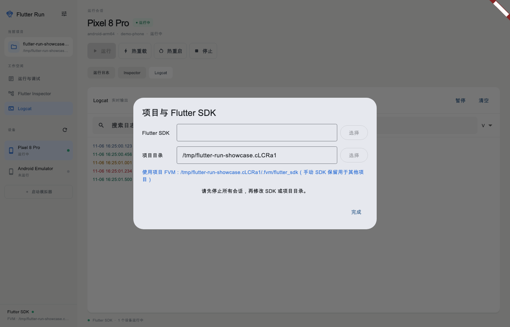

# Flutter Run

Flutter 桌面运行工具，面向 macOS、Windows 和 Linux。选择本地 Flutter SDK 和已有项目，发现设备、启动调试会话、热重载和热重启；在同一窗口查看官方 DevTools 和 Flutter 日志，Android 设备还可查看 Logcat。

## 界面截图

以下截图由当前 Flutter 界面渲染生成，项目、设备和日志均使用演示数据。

### 运行与日志



### Android Logcat



### 项目与 Flutter SDK 设置



## 开发运行

使用 FVM 固定的 Flutter 版本：

```sh
fvm install
fvm flutter pub get
fvm flutter run -d macos   # Windows: -d windows；Linux: -d linux
```

运行时选择 Flutter SDK 根目录和含 `pubspec.yaml` 的项目目录。Android Logcat 需要在 `ANDROID_SDK_ROOT`、`ANDROID_HOME` 或 PATH 中配置 adb；其他平台显示 Flutter 运行日志。Windows 需要 WebView2 Runtime，Linux 的内嵌浏览器需要插件对应的 webkit2gtk-4.1 依赖；参考 [webview_all 文档](https://pub.dev/packages/webview_all)。各目标平台仍需安装 Flutter 所需的原生工具链。

本项目处于开发阶段；不同平台和设备须分别验证，不能以本机结果替代其他平台的验证。

选择设备并运行后，可切换到其他设备再次运行同一个项目；每台设备的会话、Inspector 和日志分别管理。侧栏或状态栏菜单「新建任务窗口」可打开独立窗口，同时运行多个项目任务；每个窗口的设备、会话、日志和停止操作独立。关闭一个窗口不会关闭其他任务窗口。侧栏「切换项目」可添加本地项目并在已保存的项目之间切换，重启后保留列表和当前选择。切换后重新识别项目 SDK、刷新设备并清空上一项目的会话和日志；目录失效时保留当前项目并显示提示。活动会话存在时，SDK 和项目目录锁定，停止所有会话后可切换项目。点击系统状态栏图标后，菜单顶部直接提供当前设备的运行、热重载、热重启和停止；菜单下方可按设备操作，也支持对全部运行中的设备批量操作。关闭应用后状态栏图标也会退出。Linux 桌面需要支持 StatusNotifierItem 的系统托盘；GNOME 可能需要 AppIndicator 扩展。Linux 构建状态栏依赖 GTK 3、X11 和 Xi 开发包。

运行日志按明确的等级前缀和 Flutter 错误标记着色；没有等级信息的内容以中性色显示。日志保留原始文本与 emoji。点击左上角设置可选择项目和 Flutter SDK；旁边的外观菜单可选择跟随系统、浅色或深色模式。

选择项目后，如果项目包含 `.fvm` 或 `.fvmrc`，设备发现、模拟器启动和应用运行自动使用项目的 `.fvm/flutter_sdk`。手动 SDK 设置保留给没有 FVM 的项目；若项目 SDK 缺失或版本记录不一致，界面会提示在项目目录执行 `fvm install`。
